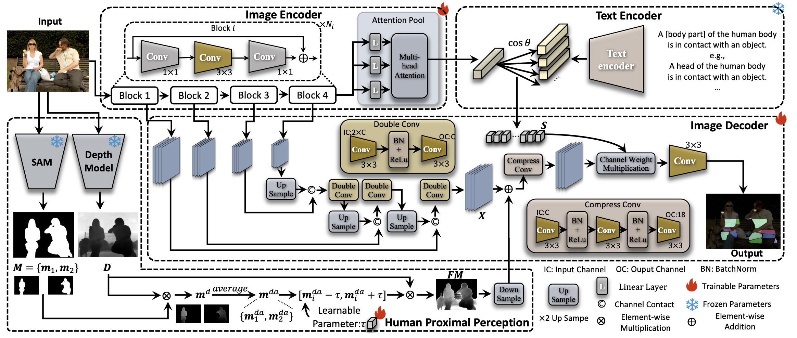

<p align="center">

  <h1 align="center">Prompt Guidance and Human Proximal Perception for HOT Prediction with Regional Joint Loss</h1>
  <p align="center">
    <strong>Yuxiao Wang</strong>, <strong>Yu Lei</strong>, <strong>Zhenao Wei</strong>, <strong>Weiying Xue</strong>, <strong>Xinyu Jiang</strong>, <strong>Nan Zhuang</strong>, <strong>Qi Liu</strong>
  </p>
  <h2 align="center">Accepted by ICCV 2025</h2>
  <div align="center">
    
  </div>

  <p align="left">
    <a href='https://arxiv.org/abs/2507.01630'>
      
    </a>
</p>

## Environment
Please first install the follow environment:
- python 3.8
- pytorch 1.11.0 (cu113)
- torchvision 0.12.0 (cu113)

## Installation
```
pip3 install -r requirements.txt
```

## Data Preparation
- Data: download the HOT dataset from the [project website](https://hot.is.tue.mpg.de) and unzip to `/path/to/dataset`. Then:
```
cd ./data
mkdir HOT
ln -s /path/to/dataset ./data/HOT
```
The directory structure is as follows:

```
Project/
├── data/
|   |── HOT
|   |   |── HOT-Annotated
|   |   |   |── images
|   |   |   |── annotations
|   |   |   |── ...
|   |   |── HOT-Generated
|   |   |   |── images
|   |   |   |── annotations
|   |   |   |── ...
│   ├── hot_train.odgt
│   ├── hot_test.odgt
│   ├── ...

```

## Segmentation Model

We use the [SAM GitHub](https://github.com/paulguerrero/lang-sam) model to generate human masks and save them in the `./data/HOT/HOT-Annotated(HOT-Generated)/segments_lang_sam` directory.


## Depth Model
[ZoeDepth](https://github.com/isl-org/ZoeDepth) is used to generate depth map. [LaMa](https://hot.is.tue.mpg.de) model in combination with the human mask to reconstruct the occluded object information.
Developers need to install the environment according to the official instructions of [ZoeDepth](https://github.com/isl-org/ZoeDepth) and save the generated depth map to the `./data/HOT/HOT-Annotated(HOT-Generated)/depth` directory.
Please note that in order to keep the original image and the inpainting image at the same perspective, they need to be spliced ​​together and sent to the [ZoeDepth](https://github.com/isl-org/ZoeDepth) model.


## Training
```
python train.py --gpus 0,1,2,3 --cfg config/hot-resnet50dilated-c1.yaml
```
To choose which gpus to use, you can either do ```--gpus 0-7```, or ```--gpus 0,2,4,6```. 

You can change the parameters in `config/hot-resnet50dilated-c1.yaml` to adjust the network training process.


## Evaluation
If you want to evaluate the effect of the test set on a specific epoch, you can use the following command:
```
sh ./test.sh
```
Note, remember to change the `--epoch` parameter.

After evaluating the model, use the following command to view the results. Note that this command will display the results of all epochs. If you evaluate the validation set first and then evaluate the test set of the specified epoch, the results displayed are the results of the validation set except for the specified test epoch.
```
sh ./show_loss.sh
```

## Citation

```bibtex
@article{wang2025prompt,
  title={Prompt Guidance and Human Proximal Perception for HOT Prediction with Regional Joint Loss},
  author={Wang, Yuxiao and Lei, Yu and Wei, Zhenao and Xue, Weiying and Jiang, Xinyu and Zhuang, Nan and Liu, Qi},
  journal={arXiv preprint arXiv:2507.01630},
  year={2025}
}
```

## Acknowledgement
For the HOT model and dataset proposed by Chen et al., please click [HOT](https://github.com/yixchen/HOT) for details.
